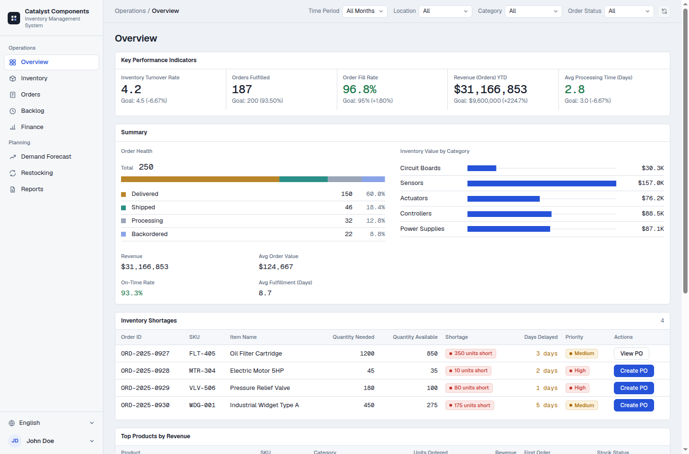

# Factory Inventory Management System

A full-stack demo application for a Claude Code workshop — inventory management, order tracking, demand forecasting, and analytics for factory operations.



## Tech Stack

- **Frontend**: Vue 3 + Vite (port 3000)
- **Backend**: Python FastAPI (port 8001)
- **Data**: Mock data from JSON files, held in memory; submitted restocking orders persist in SQLite

## Features

- Dashboard with interactive filtering and key metrics
- Inventory tracking across multiple warehouses
- Order management with status tracking
- Demand forecasting with trend analysis
- Backlog monitoring, with purchase orders for shortages
- Restocking: set a budget, get a suggested order from the demand forecast, place it
- Spending analytics and quarterly reports
- Personal task list (profile menu)

## Quick Start

**One-command startup:**
```bash
./scripts/start.sh
# Starts both backend and frontend
# Backend: http://localhost:8001
# Frontend: http://localhost:3000
# API Docs: http://localhost:8001/docs
```

**Manual startup:**

Backend:
```bash
cd server
uv venv && uv sync
uv run python main.py
```

Frontend:
```bash
cd client
npm install
npm run dev
```

## API Endpoints

Filters go in as query params: `warehouse`, `category`, `status`, `month` (`2025-01` or `Q1-2025`).

- `GET /api/inventory` - Inventory items (`warehouse`, `category`)
- `GET /api/orders` - Orders (all four filters)
- `GET /api/dashboard/summary` - Summary statistics (all four filters)
- `GET /api/reports/quarterly`, `GET /api/reports/monthly-trends` - Reports
- `GET /api/demand` - Demand forecasts with unit cost and lead time
- `GET /api/backlog` - Backlog items
- `GET /api/spending/*` - Spending data
- `GET /api/restock-orders`, `POST /api/restock-orders` - Restocking orders (SQLite)
- `POST /api/purchase-orders`, `GET /api/purchase-orders/{backlog_item_id}` - Purchase orders for backlog items (in memory)
- `GET /api/tasks`, `POST /api/tasks`, `PATCH /api/tasks/{id}` (toggle), `DELETE /api/tasks/{id}` - Tasks (in memory)

## Demo Data

Mock data includes:
- Inventory items (Circuit Boards, Sensors, Actuators, Controllers)
- Orders spanning 12 months (Delivered, Shipped, Processing, Backordered)
- Demand forecasts with trends
- Backlog items
- Spending transactions

Data files: `server/data/*.json`

## Production Build

```bash
cd client
npm run build  # Output: client/dist/
```

## Platform Notes

**macOS/Linux:** The one-command startup script (`./scripts/start.sh`) and stop script (`./scripts/stop.sh`) work out of the box.

**Windows:** The shell scripts in `scripts/` are macOS/Linux only. Use the manual startup commands instead — run each in a separate terminal:

Backend:
```bash
cd server
uv venv && uv sync
uv run python main.py
```

Frontend:
```bash
cd client
npm install
npm run dev
```

To stop the servers, press Ctrl+C in each terminal window.

---

**Note:** Demo application with in-memory data. Not production-ready without database, authentication, and security implementation.
